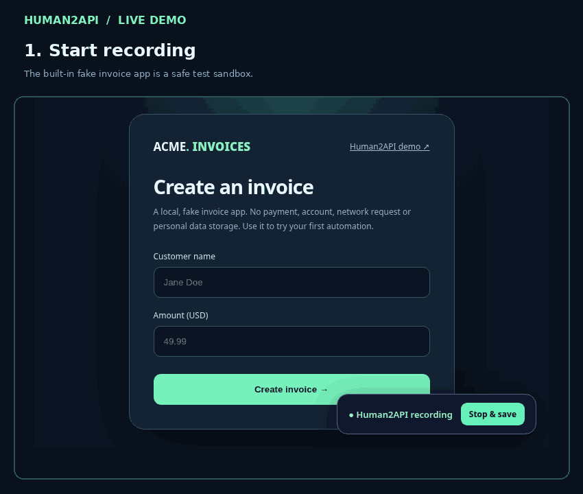

<div align="center">
  

  # Human2API

  **Teach a browser task once. Reuse it as an MCP tool, CLI command, or local REST API.**

  <p>Local-first browser automation. No cloud account. No saved typed values. No model lock-in.</p>

  [](https://github.com/karemfree1282-gif/human2api/actions/workflows/ci.yml)
  [](LICENSE)
  [](pyproject.toml)
  [](docs/API.md)
  [](SECURITY.md)

  [Arabic overview](docs/README_AR.md) · [Getting started](#quick-start) · [What works](#what-works-today) · [MCP integration](#connect-your-ai-agent) · [API](docs/API.md) · [Architecture](docs/ARCHITECTURE.md) · [Roadmap](docs/ROADMAP.md) · [Contributing](CONTRIBUTING.md)

  
</div>

---

## Why this exists

Most apps don't ship the APIs needed for every automation. A brittle script requires developer effort, and an autonomous agent can improvise incorrectly. Human2API explores a simpler workflow:

**Record in a browser → inspect the workflow → substitute runtime inputs → verify the output → expose the workflow to your tools.**

Everything is plain JSON. Nothing recorded is secretly sent to an LLM or a remote server. The v0.1 recorder uses deterministic DOM events and resilient CSS selectors; **it does not yet use an AI model, operate desktop applications, or automatically repair arbitrary broken UIs.** See [Roadmap](docs/ROADMAP.md).

## See it in action

<div align="center">
  
  <p><i>Recorded against the bundled fake-invoice app. This GIF demonstrates browser capture and JSON generation, not autonomous AI recovery.</i></p>
</div>

## Quick start

Requires **Python 3.10+** and a browser that Playwright can launch. Tested with Playwright's Chromium backend.

```bash
git clone https://github.com/karemfree1282-gif/human2api.git
cd human2api
python -m pip install -e .
python -m playwright install chromium
h2a serve
```

Open `http://127.0.0.1:8765`. The dashboard includes a **fake invoice app** at `/demo`. It does not collect or send real payments.

In another terminal, try the checked-in example while the dashboard is running:

```bash
h2a check create_invoice
h2a run create_invoice --data '{"customer_name":"Alex","amount":49.99}' --approve
```

On **Windows PowerShell**, use the same command with a JSON argument such as:

```powershell
h2a run create_invoice --data '{"customer_name":"Alex","amount":49.99}' --approve
```

You should get a verified confirmation and a local text invoice inside `runs/`. That directory is ignored by Git.

## Record your own workflow

```bash
h2a record https://example.com --name my_first_automation
```

A visible Chromium window opens. Perform clicks and form edits, then click **Stop & save** in the floating toolbar. The recorder generates `workflows/my_first_automation.json`.

**Important**: Only top-level browser tab interactions are captured in v0.1. Cross-origin iframes, drag-and-drop, OS-native dialogs, desktop apps, and multi-tab flows are not supported yet. Recording stops if the tab closes; if no actions were captured, nothing is saved. Do not use the recorder on sensitive production sites before reviewing its privacy limitations.

For example, typing a customer name creates a variable, not a saved name:

```json
{
  "action": "fill",
  "selector": "#customer-name",
  "alternatives": ["input[name=\"customer_name\"]"],
  "value": "{{customer_name}}"
}
```

The [JSON schema](schemas/workflow.schema.json) enables editor validation and completion. `workflows/` files are yours to inspect and edit. Add assertion (`assert_text`), extraction (`extract_text`), screenshot, or download steps to verify and collect outputs. Set allowed hosts explicitly for workflows that navigate between sites.

## What works today

| Capability | v0.1 |
| --- | --- |
| Browser recorder for clicks, fills, selects and checkboxes | Yes (Chromium, one tab) |
| Parametrized inputs without saving typed values | Yes |
| Human-readable JSON workflow files | Yes |
| Deterministic replay with selector fallbacks | Yes |
| Result verification, extraction and downloads | Yes |
| Local-only dashboard for running and editing workflows | Yes |
| Dynamic MCP tools from workflow files | Yes (stdio) |
| Local REST API + generated OpenAPI 3.1 | Yes |
| Domain navigation allowlist and explicit write approval | Yes |
| Arbitrary desktop app recording / Android | Not yet |
| Autonomous AI self-healing | Not yet |
| Hosted accounts or cloud sync | Not offered |

## Connect your AI agent

Human2API runs a standalone **MCP stdio server**. It exposes a typed `h2a_<workflow_name>` tool for each local workflow, plus `h2a_list_workflows`. Compatible MCP clients can spawn it using:

```json
{
  "mcpServers": {
    "human2api": {
      "command": "h2a",
      "args": ["mcp", "--directory", "/absolute/path/to/human2api/workflows"],
      "env": {"H2A_ALLOW_WRITE": "0"}
    }
  }
}
```

Write-enabled workflows are **blocked by default** in MCP. After you have reviewed your automation and configured your MCP client to ask before running tools, you can explicitly set `H2A_ALLOW_WRITE=1`. There is no built-in human approval prompt in a stdio MCP call; your MCP client must enforce user consent. The dashboard and CLI require separate approval for write workflows.

See [MCP and REST API details](docs/API.md).

## Design principles

1. **Inspectable by default**: no hidden agent instructions or arbitrary script evaluation.
2. **Privacy-sensitive recording**: typed form values are dropped at capture time, never added to a workflow file. Review URLs and selector attributes before publishing; they may themselves contain sensitive information.
3. **Constrained execution**: workflows permit only listed actions; cross-host navigations are blocked unless allowed.
4. **Portable ownership**: a small JSON file is the source of truth, not a vendor's cloud database.
5. **Permission to act**: write flows require explicit consent; treat recorded workflows as potentially powerful.

**Security note:** Browser pages can execute their own scripts and make subresource requests. Navigation allowlists are **not** a full network sandbox, and the recorder does **not** capture or encrypt authenticated browser profiles. Use a separate test account for untrusted sites. Details in [SECURITY.md](SECURITY.md).

## Commands

| Command | Purpose |
| --- | --- |
| `h2a serve` | Start local dashboard and REST service on 127.0.0.1:8765 |
| `h2a record URL --name NAME` | Record browser interactions into a workflow |
| `h2a list` | List valid installed workflows |
| `h2a check NAME` | Validate an automation |
| `h2a run NAME --data '{...}' --approve` | Replay a workflow |
| `h2a mcp --directory /path/to/workflows` | Launch MCP stdio server |
| `h2a openapi --output openapi.json` | Export an OpenAPI specification |

Run `h2a --help` for details. Set `H2A_BROWSER_PATH` if you need a specific Chromium executable.

## Contributing

We welcome bug reports, selector strategy ideas, support for additional browser interactions, documentation improvements, and security reviews. See [CONTRIBUTING.md](CONTRIBUTING.md) and the [good first issue suggestions](docs/ROADMAP.md).

```bash
python -m pip install -e '.[dev]'
python -m playwright install chromium
python -m pytest -q
```

## Publish this repository

If you received a source ZIP instead of a Git clone, follow [PUBLISHING.md](PUBLISHING.md) to create the public repository with GitHub CLI, enable Pages, and run the launch checklist. The bundled `scripts/publish_github.py` is a one-time publisher and will not overwrite an existing repository.

## Support and license

Human2API is experimental software. Use test accounts until you have inspected each workflow. Licensed under [Apache-2.0](LICENSE). This project is not affiliated with Playwright or the Model Context Protocol maintainers.

---

<div align="center">
  <b>If this solves a problem for you, leave a star, try the demo, or contribute an improvement.</b><br>
  Open source improves faster when workflows can be audited and shared safely.
</div>

## Questions and limitations

See the [FAQ](docs/FAQ.md) for supported browsers, data handling, and release limitations. This alpha is intended for reproducible demo/test automation rather than sensitive banking or production payments.

## Public website

The project website lives in `docs/` and deploys through the bundled GitHub Pages workflow after GitHub Pages is enabled for GitHub Actions. The repository must be published before any GitHub or Pages link becomes live.
