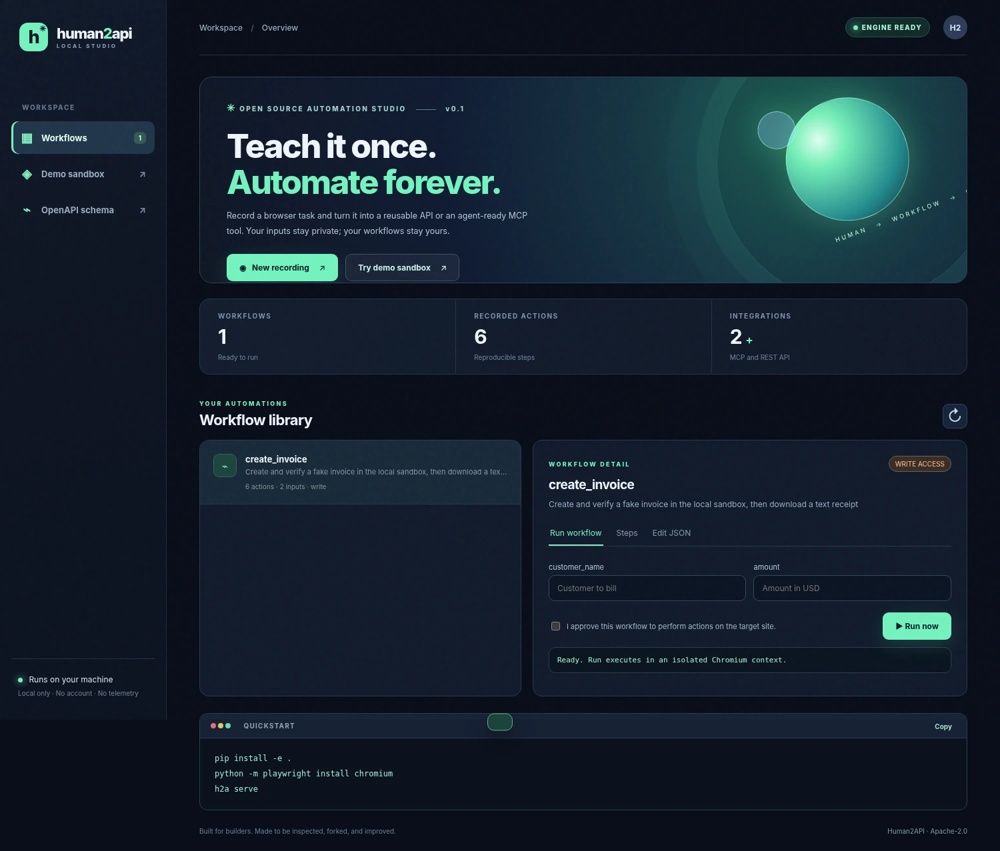

<div align="center">
  

  # Human2API

  **Teach a task once. Run it from your terminal, REST API, or any MCP-compatible AI agent.**

  <p>Browser · Windows / macOS / Linux desktop · Android (ADB) · Local-first · Open source</p>

  [](https://github.com/karemfree1282-gif/human2api/actions/workflows/ci.yml)
  [](LICENSE)
  [](pyproject.toml)
  [](docs/API.md)
  [](SECURITY.md)

  **[Arabic guide](docs/README_AR.md)** · **[Quick start](#quick-start)** · **[Platforms](#platform-support)** · **[MCP](#connect-your-ai-agent)** · **[API](docs/API.md)** · **[Security](SECURITY.md)** · **[Contribution](CONTRIBUTING.md)**

  
</div>

---

> **v0.2 development release.** The browser engine has automated local tests and the other platform engines have mocked unit tests, but physical Windows/macOS/Linux app and Android device acceptance tests are not yet complete. This project is **not** advertised as production-ready, a hosted cloud service, or a universal API for every app.

## The problem

Plenty of software has no public API. Human2API turns an *explicit, inspected workflow* into a reusable local tool. No generated code executes inside workflow definitions. Workflows are human-readable JSON, and write actions require a grant before each execution path.

```
Teach a browser / desktop / Android task
          ↓
Review & parameterize its JSON actions
          ↓
Run with verification and explicit permissions
          ↓
CLI  ·  MCP tool  ·  Local REST API
          ↓
Share a checksummed .h2a.zip workflow with others
```

## Quick start

**Browser (Python 3.10+)**

```bash
git clone https://github.com/karemfree1282-gif/human2api.git
cd human2api
python -m pip install -e .
python -m playwright install chromium
h2a serve
```

Open **http://127.0.0.1:8765**. A local fake-invoice sandbox is served at `/demo`; it never processes payments.

```bash
h2a check create_invoice
h2a run create_invoice --data '{"customer_name":"Alex","amount":49.99}' --approve
```

**Desktop (Windows, macOS, Linux)**

```bash
python -m pip install -e '.[desktop]'
h2a record-desktop --name mouse_demo
# Perform only the mouse clicks / scrolls you want recorded, then press F12.
# No keyboard content, passwords or clipboard text is captured.
h2a check mouse_demo
h2a run mouse_demo --approve
```

The desktop recorder captures **pointer actions only**. To enter values, edit the generated JSON and add `type_text` with a `{{variable}}` declaration under `inputs`. The current desktop text backend supports **ASCII**, and visible UI coordinates are resolution-dependent. Set mouse to the upper-left corner to activate PyAutoGUI's failsafe. `--show-browser` only applies to the browser target.

**Android (USB or emulator + Android platform-tools)**

1. Enable **USB debugging** on your own/test Android device and authorize the connected computer.
2. Install Android platform-tools so the `adb` executable is on PATH.
3. Record guided commands and run a workflow:

```bash
h2a devices
h2a record-android --name android_demo
# Commands: tap X Y, tap-text TEXT, input NAME, back, wait MS, assert TEXT, screenshot, done
h2a check android_demo
h2a run android_demo --approve
```

The Android recorder uses a **guided CLI** rather than passive touch capture. `input NAME` saves a placeholder, not the input value. UI text selectors are built from UIAutomator XML; Android text injection supports only a conservative ASCII subset. Device UI permissions and third-party app restrictions still apply; root is not required.

## Platform support

| Capability | Browser | Desktop | Android |
| --- | --- | --- | --- |
| Record actions | DOM events, tabs, named iframes | Pointer clicks & scroll | Guided ADB commands |
| Replay | Playwright | PyAutoGUI (optional) | Android platform-tools |
| Parameterized text input | Yes | ASCII | Restricted ASCII |
| Visual/UI assertions | DOM text | Reference image (optional OpenCV) | UIAutomator text |
| Screenshots | Yes | Yes | Yes |
| MCP / REST / CLI | Yes | Yes | Yes |
| Automatic failure recovery | Optional semantic + optional AI selector suggestions | Not yet | Not yet |
| Verified on actual target devices | Chromium DOM tests; network E2E deferred in managed environment | Mock-based tests only | Mock-based tests only |

Browser workflows are self-contained JSON. Captured form **values are discarded immediately** and replaced by input variables; URLs with query parameters are scrubbed at capture time. New-tab switching and named/ID-based first-level iframe selectors are supported. Not all browsers, operating system dialogs, canvas apps, or inaccessible desktop UIs work.

## Browser workflow recording

```bash
h2a record https://example.org --name my_browser_task
```

Interact in the new Chromium window and select **Stop & save**. The saved workflow contains CSS selectors, fallback selectors, and optional aria-label/role hints. It never stores typed values. Inspect it before running it on anything sensitive.

```json
{
  "action": "fill",
  "selector": "#customer-name",
  "alternatives": ["input[name=\"customer_name\"]"],
  "label": "Customer name",
  "value": "{{customer_name}}"
}
```

To make a write run, use `--approve`. A read-only workflow must contain only non-mutating steps. The browser engine blocks top-level/iframe navigation to unapproved hosts but is **not** a complete network sandbox: remote pages can make requests; use separate test profiles and accounts.

## Opt-in selector healing

When a browser selector no longer resolves, the runner can try **semantic aria labels/roles**. This never persists a change automatically:

```bash
h2a run create_invoice --data '{"customer_name":"Alex","amount":49.99}' --approve --heal-selectors
```

Optional AI suggestions work through **your explicitly configured OpenAI-compatible endpoint**. They are OFF by default. Enabling them transmits up to 70 **sanitized element metadata records** (IDs, names, roles, aria labels, test IDs) to the endpoint; these may still include identifying data. Form values, cookies and full HTML are not included. Always review suggestions.

```bash
export H2A_AI_ENDPOINT="https://api.openai.com/v1/chat/completions"
export H2A_AI_MODEL="gpt-4.1-mini"
export H2A_AI_API_KEY="<set-in-your-shell-not-in-source>"
h2a run create_invoice --data-file inputs.json --approve --heal-selectors --ai-heal
```

Only a unique visible element can be used as a recovered selector. AI does not execute scripts and cannot silently modify workflow files. The local dashboard also requires per-run AI-healing consent.

## Connect your AI agent

Use the MCP stdio adapter with any client supporting the MCP tools protocol:

```json
{
  "mcpServers": {
    "human2api": {
      "command": "h2a",
      "args": ["mcp", "--directory", "/absolute/path/to/workflows"],
      "env": {"H2A_ALLOW_WRITE": "0"}
    }
  }
}
```

One typed `h2a_<workflow>` tool is registered for every local valid workflow. Read-only actions work by default. Write workflows require `H2A_ALLOW_WRITE=1` and consent enforced by **your MCP client**; Human2API does not have an interactive approval dialog inside MCP.

## Share workflows: local catalog and packages

```
h2a pack create_invoice --output catalog/create_invoice.h2a.zip --publisher community
h2a catalog --catalog-dir catalog
h2a verify catalog/create_invoice.h2a.zip
h2a install catalog/create_invoice.h2a.zip --approve --directory other_workflows
```

`.h2a.zip` contains exactly a manifest and workflow JSON. Checksums detect corruption; **they do not establish who published a file**. Nothing executable gets extracted, and overwrite is disallowed. Always inspect third-party workflows and permitted hosts/actions before installing. There is a **local catalog and a public read-only HTTPS index**. It is not a managed marketplace with signed publishers, trust ratings or user accounts. Community registry submission instructions are in [marketplace/README.md](marketplace/README.md).

## Local REST API

`h2a serve` exposes only `127.0.0.1`, not the internet. The dashboard uses an ephemeral `X-H2A-Token` API header and checks Host/Origin against DNS rebinding. Use `h2a openapi --output openapi.json` or [API documentation](docs/API.md).

## Examples, tests and release state

- **Browser:** [`workflows/create_invoice.json`](workflows/create_invoice.json) — runnable against the fake invoice sandbox after starting `h2a serve`.
- **Desktop:** [`workflows/desktop_note.json`](workflows/desktop_note.json) — **illustrative coordinates only**; adjust positions for your own screen and editor before approving.
- **Android:** [`workflows/android_settings.json`](workflows/android_settings.json) — **illustrative device UI**; adapt displayed text to your phone before approving.
- Tests: `python -m pip install -e '.[dev]' && python -m pytest -q`
- Build: `python -m build`
- Security policy: [SECURITY.md](SECURITY.md); limitations and next features: [ROADMAP](docs/ROADMAP.md).

## License and contribution

Apache-2.0. Contributions and tests on real devices are especially welcome. [Contributing guide](CONTRIBUTING.md) · [Code of conduct](CODE_OF_CONDUCT.md) · [Architecture](docs/ARCHITECTURE.md) · [Issue tracker](https://github.com/karemfree1282-gif/human2api/issues).

**Want it to be trustworthy? Star the repository, try the sample, report a reproducible bug, and help close the hardware test gap.**

### Public workflow directory (preview)

The repository includes a [read-only community index](marketplace/index.json). Run `h2a catalog --remote` to view metadata; inspect the source before using `h2a install-remote create_invoice --approve`. Download and install both require HTTPS and pinned SHA-256, but publisher identities are **not cryptographically verified**. All remote actions are opt-in.
